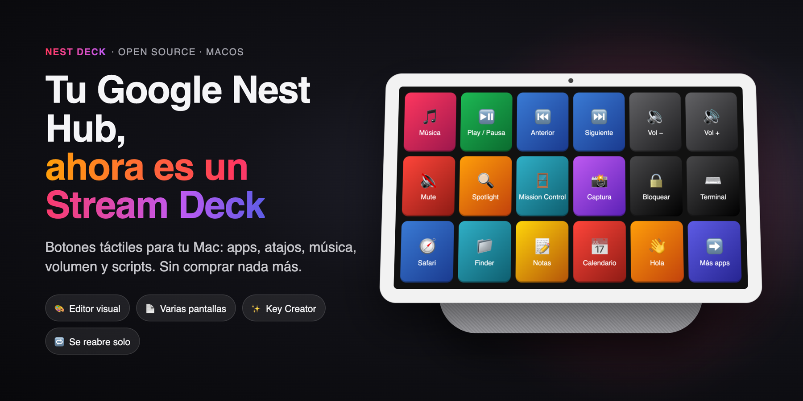
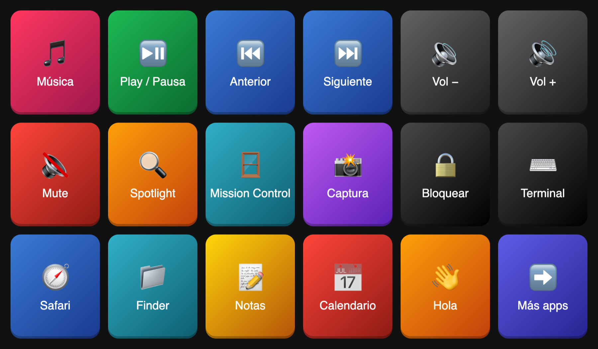
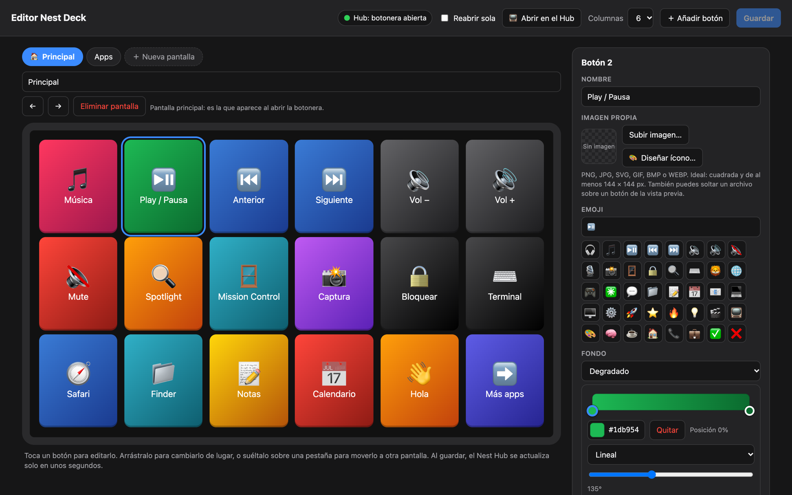
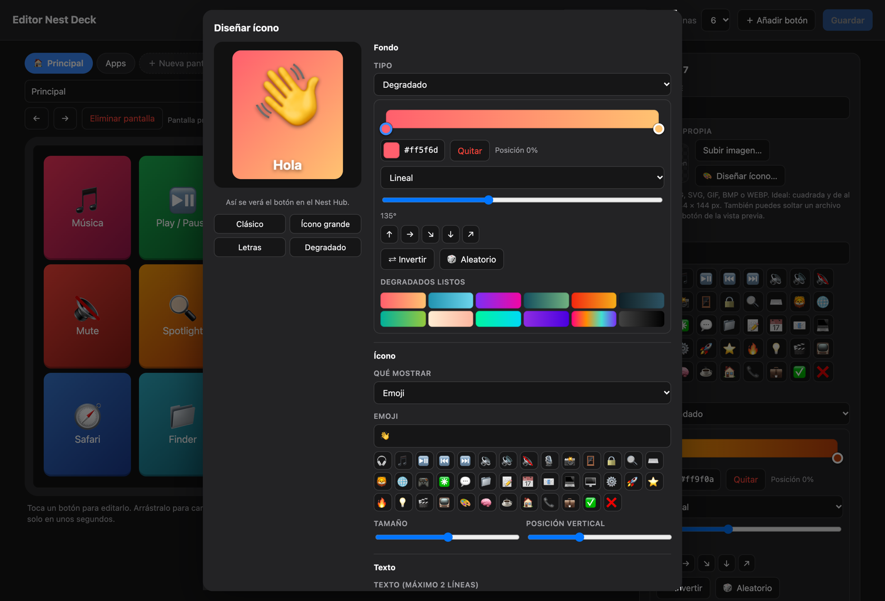
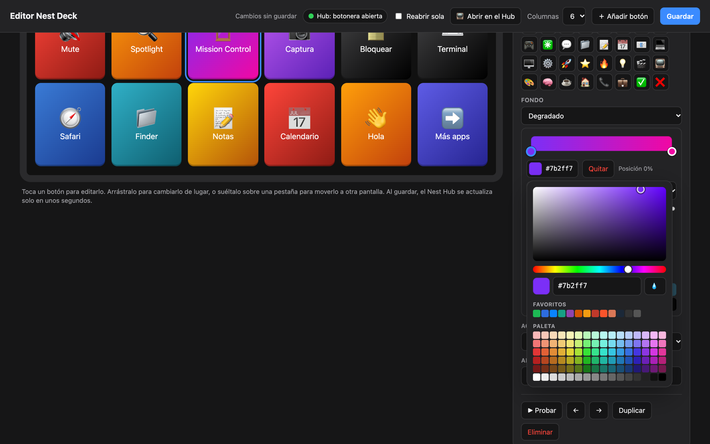
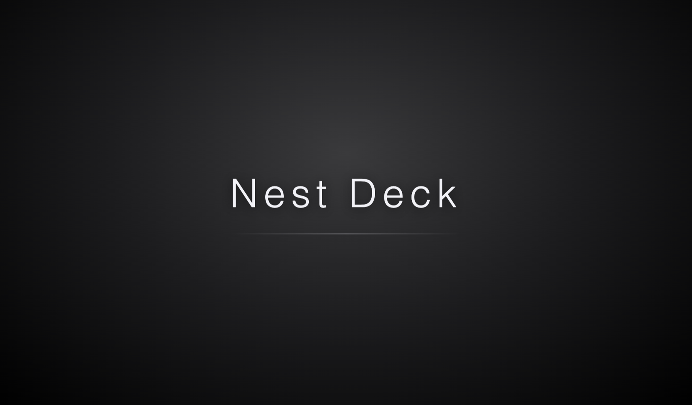
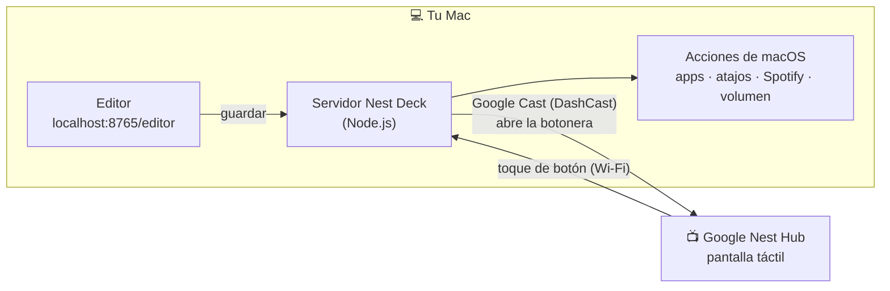

<p align="center">
  
</p>

<h1 align="center">Nest Deck</h1>

<p align="center">
  <b>Convierte el Google Nest Hub que ya tienes en un Stream Deck para tu Mac.</b><br>
  Botones táctiles para apps, atajos, música, volumen y scripts — gratis y de código abierto.
</p>

<p align="center">
  <a href="https://doi.org/10.5281/zenodo.24026336"></a>
  
  
  
  
  
</p>

<p align="center">
  <a href="README.md">🇬🇧 Read in English</a> ·
  <a href="#-empieza-en-2-minutos">Empezar</a> ·
  <a href="#-qué-puede-hacer">Funciones</a> ·
  <a href="#-preguntas-frecuentes">Preguntas</a>
</p>

---

Un Stream Deck cuesta más de 100 dólares. Un Google Nest Hub muchas veces está en el escritorio mostrando solo la hora.
**Nest Deck** le da una segunda vida: una cuadrícula de botones de colores, grandes y táctiles, que controlan tu Mac,
con un editor visual para diseñar cada botón. Sin cuentas, sin nube y sin comprar nada más.

<p align="center">
  
</p>

## ✨ Qué puede hacer

| | |
|---|---|
| 🎛️ **Botones táctiles de verdad** | Tocas en el Nest Hub y tu Mac responde al instante. |
| 🚀 **Acciones** | Abrir apps o páginas web, atajos de teclado (con botón *Grabar atajo*), control de Spotify / Apple Música, volumen y silencio, cualquier comando de terminal. |
| 📄 **Varias pantallas** | Hasta 20 pantallas con botones *ir a pantalla / siguiente / anterior / inicio*, como las carpetas del Stream Deck. |
| 🎨 **Editor visual** | Arrastrar y soltar, emojis, colores, degradados y vista previa en vivo. Los cambios llegan al Hub en ~3 segundos. |
| 🖼️ **Tus propios íconos** | Sube PNG, JPG, SVG, GIF, BMP o WEBP con recorte 1:1 integrado, o usa los que diseñes en Key Creator de Elgato. |
| ✨ **Key Creator integrado** | Diseña íconos en el editor: fondo, degradado, emoji o imagen, texto, fuentes y sombra. |
| 🌈 **Herramientas de color** | Selector de tono/brillo, hexadecimal, cuentagotas, recientes, paleta de más de 100 colores y editor de degradados de hasta 5 colores. |
| 🔎 **Sin configurar nada** | Encuentra tu Nest Hub en la red solo (y otra vez si cambia de IP). |
| 🔁 **Se repara solo** | Si el Hub cierra la botonera, se vuelve a abrir sola… sin interrumpir música, videos ni llamadas. |
| 🌅 **Arranca con tu Mac** | Ítem de inicio opcional y pantalla de bienvenida personalizable. |
| 🔒 **Privado y local** | Todo corre en tu Mac y tu Wi‑Fi. El Hub nunca recibe tus comandos. |

## 📸 Capturas

<table>
  <tr>
    <td width="50%"><p align="center"><b>Editor visual</b>: pantallas, arrastrar y soltar, degradados</p></td>
    <td width="50%"><p align="center"><b>Key Creator</b>: diseña tus íconos</p></td>
  </tr>
  <tr>
    <td width="50%"><p align="center"><b>Selector de color</b>: paleta, cuentagotas, degradados</p></td>
    <td width="50%"><p align="center"><b>Pantalla de bienvenida</b> personalizable</p></td>
  </tr>
</table>

## ⚙️ Cómo funciona



1. Un pequeño servidor en Node.js corre en tu Mac y sirve la página de botones.
2. Con el protocolo Google Cast la abre en el Nest Hub mediante **DashCast**, una app pública de Cast que muestra cualquier página web.
3. Al tocar un botón, el Hub avisa a tu Mac y la Mac ejecuta la acción (AppleScript, `open`, terminal…).

## 🚀 Empieza en 2 minutos

**Necesitas:** una Mac (probado en macOS 26; versiones anteriores probablemente funcionan), un Google Nest Hub en la **misma red Wi‑Fi** y [Node.js 18+](https://nodejs.org).
Se recomiendan las herramientas de línea de comandos de Xcode (`xcode-select --install`) para que los emojis se vean perfectos en el Hub.

```bash
git clone https://github.com/pietrov07-spec/nest-deck.git
cd nest-deck
./instalar.sh
```

El instalador descarga la única dependencia, compila dos ayudantes nativos pequeños, crea tu `deck.json` a partir del
ejemplo y busca tu Nest Hub. Luego **dale doble clic a `Nest Deck.command`** y la botonera aparece en tu Hub.

Abre el editor en **http://localhost:8765/editor** y hazla tuya.

### Permisos de macOS (una sola vez)

Dáselos a **Terminal** cuando macOS los pida (Ajustes del Sistema → Privacidad y seguridad):

| Permiso | Para qué |
|---|---|
| **Red local** | Para encontrar y hablar con el Nest Hub. |
| **Accesibilidad** | Para enviar atajos de teclado. |
| **Automatización → Spotify / Música** | Para controlar la música (se pide la primera vez que tocas Play). |

> Deja abierta la ventana de Terminal (puedes minimizarla). Si la cierras, Nest Deck se detiene.

## 🧩 Acciones de los botones

| Acción | Ejemplo |
|---|---|
| Abrir app | Spotify, Safari, Finder… (el editor sugiere tus apps instaladas) |
| Abrir página web | `https://github.com` |
| Atajo de teclado | ⌘C, ⌘⇧A, ⌃⌘Q — pulsa **Grabar atajo** y escríbelo |
| Tecla especial | Retorno, Esc, flechas, F1–F12 |
| Control de música | Play/Pausa, Siguiente, Anterior en Spotify o Apple Música |
| Volumen / Silencio | Volumen ±10 o el paso que quieras |
| Comando de terminal | `say "Hola"`, scripts, `open -a …` |
| Ir a otra pantalla | Una pantalla concreta, la principal, la siguiente o la anterior |

Cada botón puede tener **nombre, emoji o imagen, color o degradado**, y el estilo *ícono + nombre* o *imagen completa*.

## 🗂️ Configuración (`deck.json`)

Todo lo que haces en el editor se guarda en `deck.json` (es tuyo y Git lo ignora). Punto de partida: [`deck.example.json`](deck.example.json).

```jsonc
{
  "port": 8765,
  "nestHubIp": "",            // vacío = se busca solo
  "autoReopen": true,         // reabrir la botonera si el Hub la cierra
  "welcome": { "enabled": true, "text": "Nest Deck" },
  "pages": [
    { "id": "principal", "name": "Principal", "columns": 6, "buttons": [
      { "label": "Play / Pausa", "icon": "⏯️", "color": "#1db954",
        "gradient": { "type": "linear", "angle": 135, "stops": [{ "pos": 0, "color": "#1db954" }, { "pos": 100, "color": "#0b6b2f" }] },
        "action": { "type": "media", "command": "playpause", "app": "Spotify" } }
    ] }
  ]
}
```

## ❓ Preguntas frecuentes

<details>
<summary><b>¿Con qué dispositivos Nest funciona?</b></summary>

Probado en un Google Nest Hub con Fuchsia OS. Otros modelos de Nest Hub (incluido el Hub Max) deberían funcionar, pero no están probados — ¡cuéntanos! Los altavoces sin pantalla no sirven.
</details>

<details>
<summary><b>La botonera desapareció del Hub. ¿Cómo la recupero?</b></summary>

- Si el Hub volvió al reloj o las fotos, se reabre sola en menos de un minuto.
- O pulsa **📺 Abrir en el Hub** en el editor.
- Si el editor no carga, Nest Deck está apagado: doble clic en **`Nest Deck.command`**.
</details>

<details>
<summary><b>¿Interrumpe mi música o una videollamada en el Hub?</b></summary>

No. Si hay otra app en uso, Nest Deck espera a que el Hub vuelva al reposo.
</details>

<details>
<summary><b>¿Se puede quitar la pantalla de carga de “DashCast”?</b></summary>

Con DashCast no: esa pantalla es de la app pública de Cast. Lo que sí puedes personalizar es la bienvenida que aparece después (`welcome` en `deck.json`). Un receptor de Cast propio la quitaría, pero requiere registrarse con Google.
</details>

<details>
<summary><b>¿Windows o Linux?</b></summary>

Nest Deck es para macOS (las acciones usan AppleScript y herramientas de macOS). Para Windows está el [NestDeck](https://github.com/achinita/NestDeck) original.
</details>

<details>
<summary><b>¿Es seguro?</b></summary>

El editor (que puede crear botones que ejecutan comandos) solo responde a tu propia Mac (`localhost`, con una cabecera propia), así que otros equipos de tu red no pueden cambiar tu botonera. El Hub solo recibe nombres, colores e imágenes, nunca los comandos. Un toque solo ejecuta acciones que tú definiste.
</details>

<details>
<summary><b>¿Qué pasa si mi Mac se duerme?</b></summary>

Los botones no responden hasta que despierte. Conviene mantenerla despierta mientras usas la botonera.
</details>

## 🛠️ Estructura del proyecto

| Archivo | Qué hace |
|---|---|
| `server.js` | Servidor HTTP, acciones, API del editor y vigilante que reabre la botonera |
| `castlib.js` | Google Cast: buscar el Hub, ver qué muestra y abrir la botonera con DashCast |
| `public/index.html` | La página que se ve en el Nest Hub |
| `public/editor.html` | El editor visual (pantallas, recorte, Key Creator, color) |
| `mediakey.swift`, `emoji2png.swift` | Ayudantes nativos: teclas multimedia y emojis de Apple para la fuente vieja del Hub |
| `instalar.sh`, `iniciar.sh`, `Nest Deck.command` | Instalador, arranque y lanzador de doble clic |
| [`docs/BITACORA.md`](docs/BITACORA.md) | Bitácora: cada problema que apareció y cómo se resolvió |

## 🗺️ Ideas y próximos pasos

- [ ] Interfaz en inglés / traducciones
- [ ] Botones con estado (silencio activado, canción actual de Spotify)
- [ ] Acciones de OBS y Home Assistant
- [ ] Monitor de hardware (CPU, RAM)
- [ ] Íconos GIF animados
- [ ] Receptor de Cast propio (sin la pantalla de DashCast)

Ideas, reportes y pull requests son bienvenidos. Si Nest Deck le dio una segunda vida a tu Hub, **deja una ⭐**: ayuda a que otros lo encuentren.

## 📚 Citar este proyecto

Si lo usas en un trabajo académico, usa el botón **Cite this repository** de
GitHub (lee [CITATION.cff](CITATION.cff)) o cita el DOI, que siempre apunta a la versión más reciente:

> Vazquez, F. (2026). *Nest Deck: convierte tu Google Nest Hub en un Stream Deck para Mac* (Versión 1.0.0) [Software]. Zenodo. https://doi.org/10.5281/zenodo.24026336

## 🙏 Créditos

- Inspirado en [**NestDeck**](https://github.com/achinita/NestDeck) de achinita (Windows); esta es una versión independiente para macOS.
- La app pública de Cast **DashCast**, para mostrar páginas web en dispositivos Cast, y [castv2-client](https://github.com/thibauts/node-castv2-client) para el protocolo Cast.
- Hecho con ayuda de [Claude Code](https://claude.com/claude-code).

Sin relación con Google ni con Elgato. Google Nest Hub es marca de Google LLC; Stream Deck es marca de Corsair / Elgato.

## 📄 Licencia

[MIT](LICENSE)
