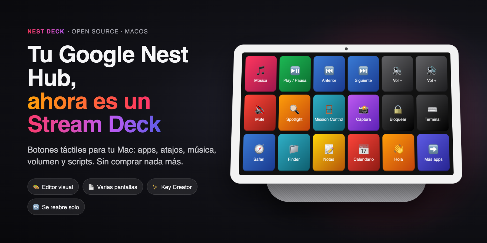
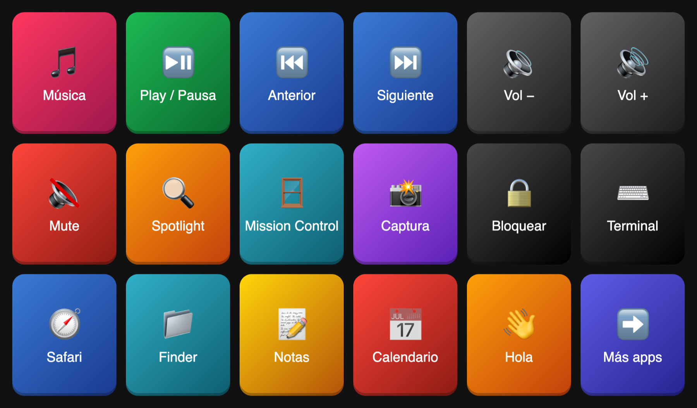
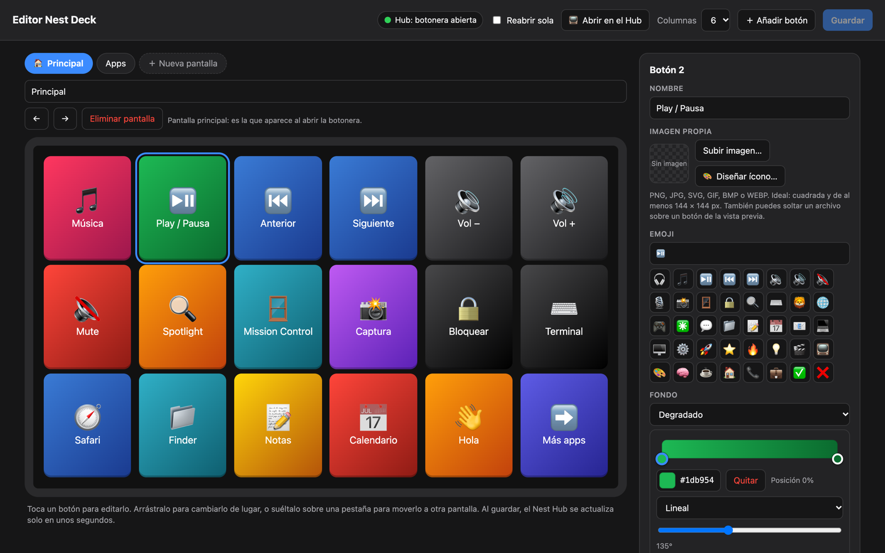
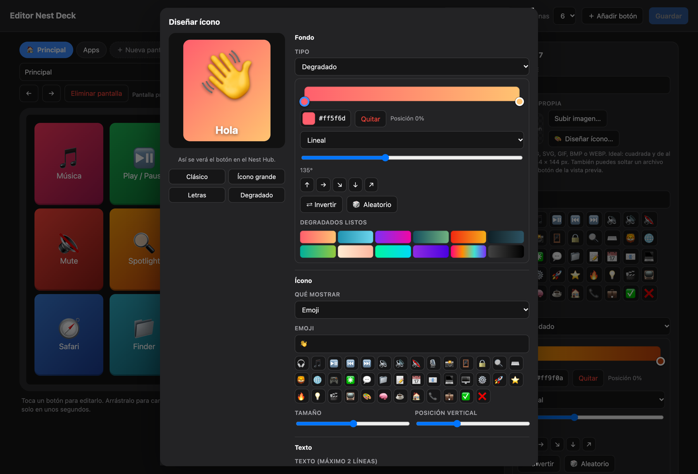
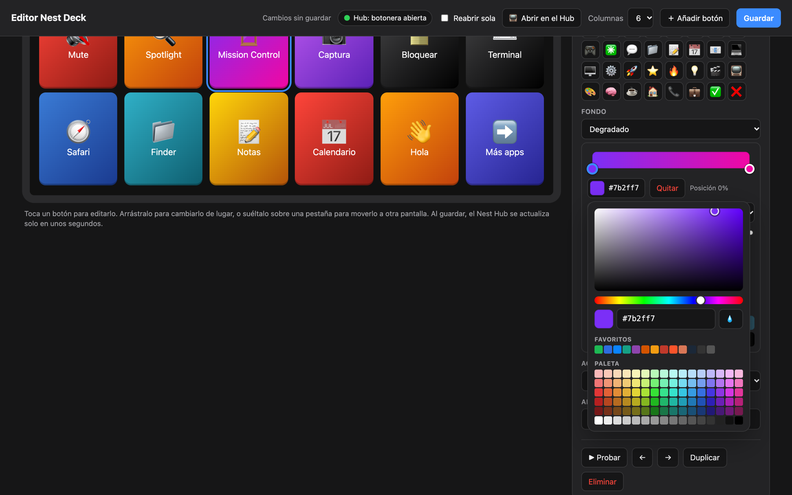
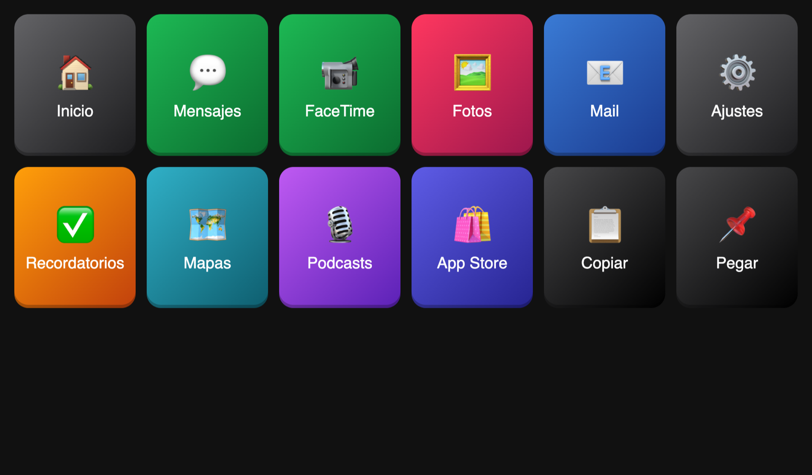
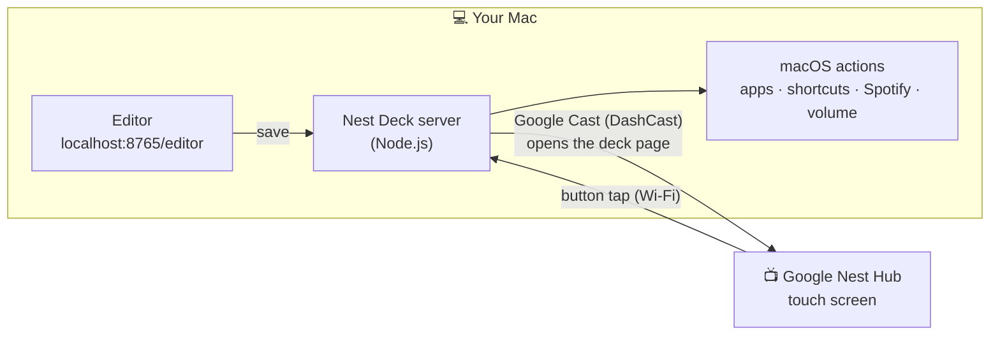

<p align="center">
  
</p>

<h1 align="center">Nest Deck</h1>

<p align="center">
  <b>Turn the Google Nest Hub you already own into a Stream Deck for your Mac.</b><br>
  Touch buttons for apps, shortcuts, music, volume and scripts — free and open source.
</p>

<p align="center">
  <a href="https://doi.org/10.5281/zenodo.24026336"></a>
  
  
  
  
  
</p>

<p align="center">
  <a href="https://nest-deck-demo.vercel.app"></a>
</p>

<p align="center">
  <a href="README.es.md">🇪🇸 Leer en español</a> ·
  <a href="#-quick-start">Quick start</a> ·
  <a href="#-features">Features</a> ·
  <a href="#-faq">FAQ</a>
</p>

---

A Stream Deck costs well over $100. A Google Nest Hub is often sitting on a desk doing nothing but showing the time.
**Nest Deck** gives it a second life: a full‑screen grid of colorful, touch‑friendly buttons that control your Mac,
with a visual editor to design every button — no account, no cloud, no extra hardware.

<p align="center">
  
</p>

## ✨ Features

| | |
|---|---|
| 🎛️ **Real touch buttons** | Tap on the Nest Hub, your Mac reacts instantly. |
| 🚀 **Actions** | Open apps or websites, keyboard shortcuts (with a *record shortcut* button), Spotify / Apple Music controls, volume & mute, any shell command. |
| 📄 **Multiple pages** | Unlimited\* screens with *go to page / next / previous / home* buttons — like Stream Deck folders. |
| 🎨 **Visual editor** | Drag & drop, emojis, colors, gradients, live preview. Changes appear on the Hub in ~3 seconds. |
| 🖼️ **Your own icons** | Upload PNG, JPG, SVG, GIF, BMP or WEBP with a built‑in 1:1 cropper — or use icons made in Elgato's Key Creator. |
| ✨ **Key Creator built in** | Design icons in the editor: backgrounds, gradients, emoji or image, text, fonts, shadows. |
| 🌈 **Color tools** | HSV picker, hex input, eyedropper, recent colors, 100+ color palette, gradient editor with up to 5 stops. |
| 🔎 **Zero config** | Finds your Nest Hub on the network automatically (and again if its IP changes). |
| 🔁 **Self‑healing** | If the Hub closes the deck, it reopens by itself — but never interrupts music, videos or calls. |
| 🌅 **Starts with your Mac** | Optional login item; custom welcome screen on the Hub. |
| 🔒 **Private & local** | Everything runs on your Mac and your Wi‑Fi. The Hub never receives your commands. |

<sub>\* up to 20 pages.</sub>

## 📸 Screenshots

<table>
  <tr>
    <td width="50%"><p align="center"><b>Visual editor</b> — pages, drag & drop, gradients</p></td>
    <td width="50%"><p align="center"><b>Key Creator</b> — design your own icons</p></td>
  </tr>
  <tr>
    <td width="50%"><p align="center"><b>Color picker</b> — palette, eyedropper, gradients</p></td>
    <td width="50%"><p align="center"><b>Multiple pages</b> on the Hub</p></td>
  </tr>
</table>

## ⚙️ How it works



1. A small Node.js server runs on your Mac and serves the button page.
2. Using the Google Cast protocol, it opens that page on the Nest Hub through **DashCast**, a public Cast app that displays any web page.
3. When you tap a button, the Hub tells your Mac, and the Mac runs the action (AppleScript, `open`, shell…).

## 🚀 Quick start

**Just curious?** Open the **[live demo](https://nest-deck-demo.vercel.app)**: the Hub screen, the visual editor and a simulated Mac that shows what each button would do, all in your browser. Switch to English with the EN button.

**You need:** a Mac (tested on macOS 26 — earlier versions likely work), a Google Nest Hub on the **same Wi‑Fi**, and [Node.js 18+](https://nodejs.org).
Xcode command line tools are recommended (`xcode-select --install`) so emojis render perfectly on the Hub.

```bash
git clone https://github.com/pietrov07-spec/nest-deck.git
cd nest-deck
./instalar.sh
```

The installer downloads the one dependency, builds two tiny native helpers, creates your `deck.json` from the
example and looks for your Nest Hub. Then **double‑click `Nest Deck.command`** — the deck appears on your Hub.

Open the editor at **http://localhost:8765/editor** and make it yours.

### macOS permissions (one time)

Grant these to **Terminal** when macOS asks (System Settings → Privacy & Security):

| Permission | Why |
|---|---|
| **Local Network** | To find and talk to the Nest Hub. |
| **Accessibility** | To send keyboard shortcuts. |
| **Automation → Spotify / Music** | To control playback (asked the first time you press Play). |

> Keep the Terminal window open (you can minimize it). Closing it stops Nest Deck.

## 🧩 Button actions

| Action | Example |
|---|---|
| Open app | Spotify, Safari, Finder… (the editor suggests your installed apps) |
| Open website | `https://github.com` |
| Keyboard shortcut | ⌘C, ⌘⇧A, ⌃⌘Q — press **Record shortcut** and type it |
| Special key | Return, Esc, arrows, F1–F12 |
| Music control | Play/Pause, Next, Previous in Spotify or Apple Music |
| Volume / Mute | Volume ±10 or any step |
| Shell command | `say "Hello"`, scripts, `open -a …` |
| Go to page | A specific page, home, next or previous |

Every button can have a **name, emoji or image, color or gradient**, and the style *icon + label* or *full image*.

## 🗂️ Configuration (`deck.json`)

Everything you do in the editor is saved to `deck.json` (it's yours and is git‑ignored). Starting point: [`deck.example.json`](deck.example.json).

```jsonc
{
  "port": 8765,
  "nestHubIp": "",            // empty = find it automatically
  "autoReopen": true,         // reopen the deck if the Hub closes it
  "welcome": { "enabled": true, "text": "Nest Deck" },
  "pages": [
    { "id": "principal", "name": "Principal", "columns": 6, "buttons": [
      { "label": "Play / Pause", "icon": "⏯️", "color": "#1db954",
        "gradient": { "type": "linear", "angle": 135, "stops": [{ "pos": 0, "color": "#1db954" }, { "pos": 100, "color": "#0b6b2f" }] },
        "action": { "type": "media", "command": "playpause", "app": "Spotify" } }
    ] }
  ]
}
```

## ❓ FAQ

<details>
<summary><b>Which Nest devices work?</b></summary>

Tested on a Google Nest Hub running Fuchsia OS. Other Nest Hub models (including the Hub Max) should work but are untested — reports welcome! Speakers without a screen won't work.
</details>

<details>
<summary><b>The deck disappeared from the Hub. How do I bring it back?</b></summary>

- If the Hub went back to the clock/photos, it reopens by itself in under a minute.
- Or press **📺 Open on the Hub** in the editor.
- If the editor doesn't load, Nest Deck is stopped: double‑click **`Nest Deck.command`**.
</details>

<details>
<summary><b>Will it interrupt my music or a video call on the Hub?</b></summary>

No. If another app is in use, Nest Deck waits until the Hub is idle again.
</details>

<details>
<summary><b>Can I remove the “DashCast” loading screen?</b></summary>

Not with DashCast — that screen belongs to the public Cast app. You can customize the welcome screen that follows it (`welcome` in `deck.json`). A custom Cast receiver would remove it, but it requires registering with Google.
</details>

<details>
<summary><b>Windows / Linux?</b></summary>

Nest Deck targets macOS (actions use AppleScript and macOS tools). For Windows, see the original [NestDeck](https://github.com/achinita/NestDeck).
</details>

<details>
<summary><b>Is it safe?</b></summary>

The editor (which can create buttons that run commands) only answers requests from your own Mac (`localhost`, with a custom header), so other devices on your network can't change your deck. The Hub only receives labels, colors and images — never the commands. Button presses only run actions you defined.
</details>

<details>
<summary><b>What happens when my Mac sleeps?</b></summary>

Buttons stop responding until it wakes up. Consider keeping it awake while you use the deck.
</details>

## 🛠️ Project structure

| File | What it does |
|---|---|
| `server.js` | HTTP server, button actions, editor API, watchdog that reopens the deck |
| `castlib.js` | Google Cast: find the Hub, check what it shows, open the deck via DashCast |
| `public/index.html` | The page shown on the Nest Hub |
| `public/editor.html` | The visual editor (pages, cropper, Key Creator, color tools) |
| `mediakey.swift`, `emoji2png.swift` | Native helpers: media keys, and Apple‑emoji rendering for the Hub's older font |
| `instalar.sh`, `iniciar.sh`, `Nest Deck.command` | Installer, launcher and double‑click starter |
| `demo/`, `vercel.json` | Live demo: a service worker plays the Mac's role in the browser (`node demo/build.mjs`) |
| [`docs/BITACORA.md`](docs/BITACORA.md) | Build log (in Spanish): every problem found and how it was solved |

The UI is in Spanish 🇪🇸 — translations are very welcome!

## 🗺️ Roadmap & ideas

- [ ] English UI / i18n
- [ ] Toggle buttons with state (mute on/off, Spotify now playing)
- [ ] OBS / Home Assistant actions
- [ ] Hardware monitor widgets (CPU, RAM)
- [ ] Animated GIF icons
- [ ] Custom Cast receiver (no DashCast splash)

Ideas, issues and pull requests are welcome. If Nest Deck gave your Hub a second life, **leave a ⭐** — it helps others find it.

## 📚 Cite this project

If you use it in academic work, use the **Cite this repository** button on GitHub
(it reads [CITATION.cff](CITATION.cff)) or cite the DOI, which always points to the latest version:

> Vazquez, F. (2026). *Nest Deck: Turn your Google Nest Hub into a Stream Deck for Mac* (Version 1.0.0) [Computer software]. Zenodo. https://doi.org/10.5281/zenodo.24026336

## 🙏 Credits

- Inspired by [**NestDeck**](https://github.com/achinita/NestDeck) by achinita (Windows) — this is an independent macOS take on the idea.
- The public **DashCast** Cast app for showing web pages on Cast devices, and [castv2-client](https://github.com/thibauts/node-castv2-client) for the Cast protocol.
- Built with the help of [Claude Code](https://claude.com/claude-code).

Not affiliated with Google or Elgato. Google Nest Hub is a trademark of Google LLC; Stream Deck is a trademark of Corsair / Elgato.

## 📄 License

[MIT](LICENSE)
